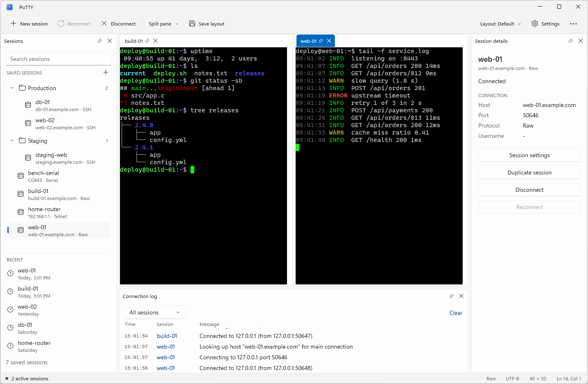
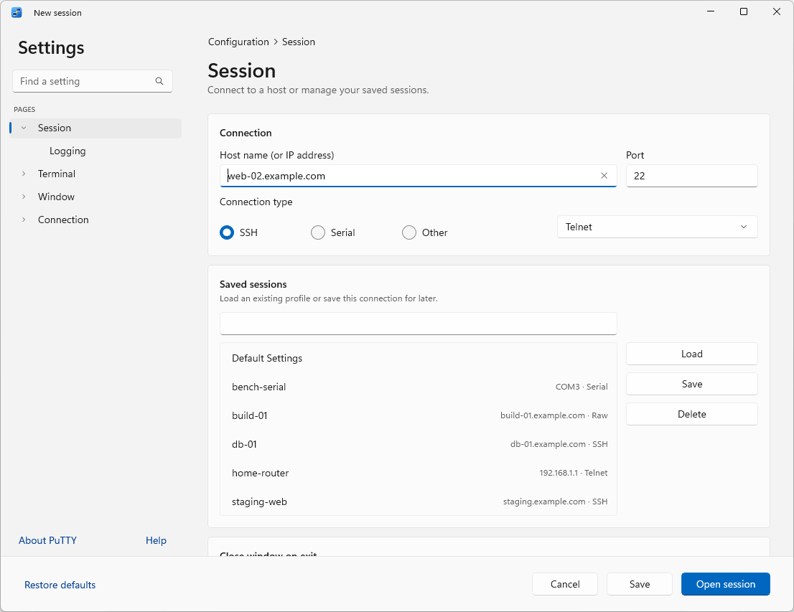
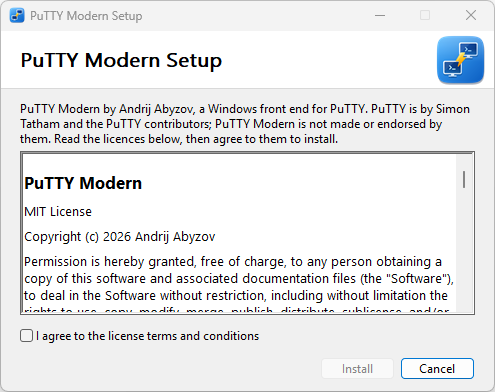

# PuTTY Modern



PuTTY Modern is a Windows SSH and terminal client that keeps what people trust in [PuTTY](https://www.chiark.greenend.org.uk/~sgtatham/putty/) (its connections, its terminal and its settings) and gives it a modern window: tabs, split panes, a session list with folders and search, and a settings window you can search.

## Why

PuTTY has done its job well for more than twenty-five years, but its Windows front end is still one window per session and one dialog with more than thirty pages. If you work on several servers, you end up with a taskbar full of identical black windows and a settings box you have to know your way around.

PuTTY Modern changes what you look at and leaves the hard part alone. SSH, key handling, Telnet, the terminal emulator and every setting are PuTTY's own code, not a rewrite, so connections behave the way PuTTY's do. Your saved sessions and host keys are the ones PuTTY already has, so you can start using it without moving anything, and go back to PuTTY whenever you like.

## What you get

- **Tabs and split panes.** Open each session in a tab, drag a tab to split the area, or pick an arrangement (side by side, stacked, three columns, a grid, one large and two small). Save an arrangement as a named layout. The workspace you left comes back the next time you start.
- **A session list you can live in.** Your saved PuTTY sessions in folders you make, a search box that looks at names, hosts and folders, the five you used last, and each session's host and protocol under its name. The sessions and the host keys you have accepted are PuTTY's own, in the same place in the registry (`HKCU\Software\SimonTatham\PuTTY`), so PuTTY and PuTTY Modern see the same ones: sessions you save in one are there in the other. (The folders are only PuTTY Modern's.)
- **Settings that are easy to find.** All of PuTTY's settings, in the same places, as a tree of pages with a "Find a setting" box. Change the settings of a running session and see them apply.
- **Connection log and session details.** PuTTY's own event log for every session in one list, and for the open tab its host, port, protocol, key exchange, cipher and the host key's fingerprint, with Reconnect, Duplicate and Disconnect one click away.
- **Everything PuTTY connects with.** SSH (password, keyboard-interactive, key files, Pageant, host key confirmation, port forwarding, X11 forwarding to an X server on Windows), Telnet, Rlogin, raw sockets and serial lines, with PuTTY's proxy and logging settings.
- **A terminal that draws well.** PuTTY's emulator with Direct2D drawing: true colour, line and box drawing characters that join up, Powerline symbols, selection, paste, scrollback with a scroll bar, and a mouse that works in programs that use it.
- **Safe when something goes wrong.** If PuTTY's code hits a fatal error, the tabs are saved first and come back on the next start.



## Install

1. Download **`PuTTYModernSetup.exe`** from the [Releases](https://github.com/drolevar/putty-modern/releases) page.
2. Run it and agree to the licences. It installs the Microsoft Visual C++ runtime first if the machine needs it, then the program for all users, with a Start menu entry. It asks for administrator rights.



The same package without the runtime step is `PuTTYModern.msi`; use it only where the Visual C++ 2015-2022 x64 runtime is already installed. `PuTTYModernSetup.exe /quiet` installs without windows, and `PuTTYModernSetup.exe /uninstall` removes it (so does Settings, then Apps).

**Requirements:** 64-bit Windows 10 version 1809 (build 17763) or later. That is the oldest version the Windows App SDK, which the window is built on, supports and the one this project declares; it has only been tried on Windows 11. The installers are not signed yet, so Windows SmartScreen will ask you to confirm: choose "More info", then "Run anyway".

## Build from source

You need Visual Studio 2026 with the C++ desktop tools, and the .NET SDK named in `global.json` (11.0.100).

```
git clone --recurse-submodules https://github.com/drolevar/putty-modern.git
cd putty-modern
dotnet build PuTTY.slnx -c Release                 # the native engine, the app and the test projects
dotnet test --solution PuTTY.slnx -c Release
dotnet publish src/PuTTY.App -c Release -r win-x64 # the NativeAOT build, in artifacts/publish
dotnet build installer/PuTTY.Setup.Bundle/PuTTY.Setup.Bundle.wixproj -c Release   # the installers
```

## Credit and licences

PuTTY Modern was created by Andrij Abyzov and is under the MIT licence ([LICENSE](LICENSE)). A large part of what runs is PuTTY's own code, by Simon Tatham and the PuTTY contributors, included unmodified in `external/putty`; a few files in `native/engine` adapt code from PuTTY for Windows, as their headers say. PuTTY is © 1997–2026 Simon Tatham and is MIT-licensed. PuTTY Modern is independent and not affiliated with or endorsed by the PuTTY team.

PuTTY's licence, word for word, and the licences of the other software PuTTY Modern contains are in [THIRD-PARTY-NOTICES.txt](THIRD-PARTY-NOTICES.txt) (the .NET runtime's own third-party notices are in [notices/](notices/)). The same text is shown by the installers and under About, then Licences, in the program.
